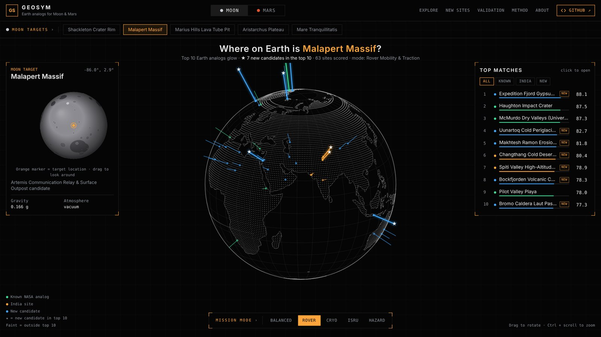
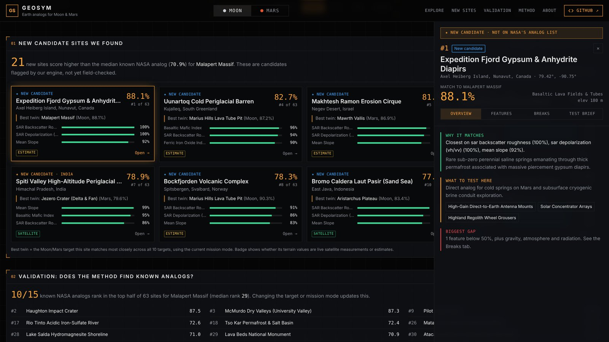
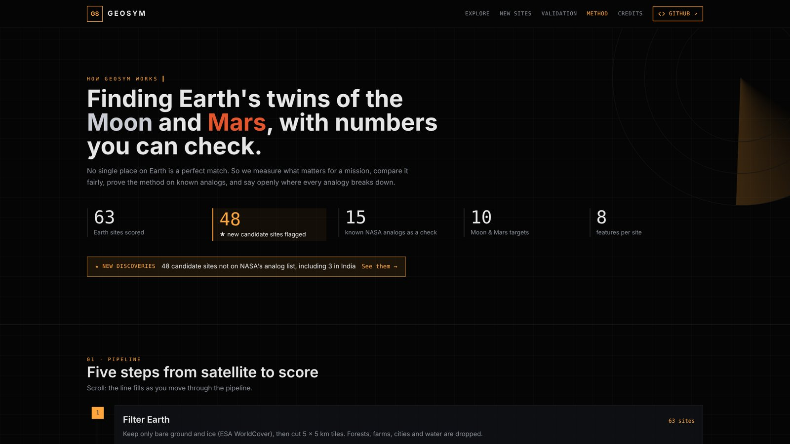

# GEOSYM: Geospatial Extractor of Orbital Similarities & Yield Metrics

**2026 NASA Space Apps Challenge** · Challenge: *Identify Earth Locations that Analog the Permanent Moon Base Locations and Mars*

**Live app: [geosym.vercel.app](https://geosym.vercel.app/)**

GEOSYM scores Earth sites against Moon and Mars mission targets on 8 physical features, shows the best matches on an interactive globe, flags **new candidate sites** that are not on NASA's analog list, and says openly where every analogy breaks down.

- **63 Earth sites** (15 known NASA analogs as a validation check + 48 new candidates, including sites in India)
- **10 targets** (5 Moon incl. Artemis south-pole regions, 5 Mars incl. Jezero and Arcadia Planitia)
- **5 mission modes** (Rover, Cryo, ISRU, Hazard, Balanced) that re-weight the features live

[](https://geosym.vercel.app/)

<table>
  <tr>
    <td width="50%"></td>
    <td width="50%"></td>
  </tr>
  <tr>
    <td align="center"><sub>New candidate sites and a site card</sub></td>
    <td align="center"><sub>Method page: every score can be checked</sub></td>
  </tr>
</table>

---

## Quick start (any machine)

**Requirements:** Node.js **18.17 or newer** (20 LTS recommended, see `.nvmrc`) and **pnpm 9+** (or npm).

```bash
git clone https://github.com/pr1hm/GEOSYM-Geospatial-Extractor-of-Orbital-Similarities-Yield-Metrics.git geosym
cd geosym

# install pnpm once if you don't have it
npm install -g pnpm

pnpm install          # uses the committed pnpm-lock.yaml
pnpm dev              # http://localhost:3000
```

No API keys are needed to run the app. The precomputed data lives in `public/data/`.

Optional: copy `.env.example` to `.env.local` and set `GROQ_API_KEY` to enable the AI field-test brief. Without it, the button uses a built-in template.

Other commands:

| Command | What it does |
| --- | --- |
| `pnpm build` | Production build (also type-checks) |
| `pnpm start` | Serve the production build |
| `pnpm typecheck` | TypeScript check only |

Using npm instead of pnpm also works: `npm install && npm run dev`.

**Windows / PowerShell:** if you see *"running scripts is disabled"* after installing pnpm, run `Set-ExecutionPolicy -Scope CurrentUser RemoteSigned` once.

### Deploy

Import the repo on [Vercel](https://vercel.com) (framework: Next.js, default settings). Add `GROQ_API_KEY` as an environment variable if you want live AI briefs.

---

## What's in the app

| Page | Highlights |
| --- | --- |
| `/` Explorer | Moon/Mars switch in the navbar · target strip · dotted Earth globe where spike height = match score, top 10 glow, ★ = new candidate · mini Moon/Mars globe with the target's location · top matches · mission-mode bar · side drawer per site (Overview, Features, Breaks, Test brief) · **New candidate sites** showcase with each site's best Moon/Mars twin · validation panel · fine-tune feature weights |
| `/method` | Animated pipeline · interactive "try the math" playground · flip cards for the 8 features · Earth's limits (gravity, atmosphere, radiation) · AI use & credits |

### How a match is scored

Every site and target is described by the same 8 features, each scaled to 0–1 with fixed physical bounds:

```
match = 1 − Σ wᵢ · |earthᵢ − targetᵢ| / Σ wᵢ
```

Weights come from the selected mission mode (or the sliders). This weighted distance respects magnitude, unlike cosine similarity. Code: `src/lib/similarityEngine.ts`.

**Validation:** known NASA analogs (Haughton Crater, Atacama, McMurdo Dry Valleys, …) should rank high. The app shows how many land in the top half for the selected target.

### Data provenance (shown as badges in the UI)

| Feature | Source | Status in this build |
| --- | --- | --- |
| Mean slope, terrain ruggedness (TRI) | Copernicus DEM GLO-30 | **Satellite**: extracted live via Microsoft Planetary Computer STAC (54 of 63 sites) |
| SAR roughness, SAR depolarization | Sentinel-1 RTC | **Satellite**: extracted live (54 of 63 sites) |
| Diurnal thermal swing, minimum night temperature | MODIS LST | **Estimate**: calibrated values |
| Iron-oxide index, basaltic mafic index | HLS (Landsat/Sentinel-2) | **Estimate**: calibrated values |
| Moon / Mars target values | LRO, MRO mission literature | **Reference** values |

9 sites where live extraction failed fall back to estimates for every feature (listed in `src/lib/provenance.ts`). The morphology-embedding experiment in the pipeline is **off** in the app, because the current pipeline feeds the model constant grids rather than real imagery.

---

## Repository structure

```text
geosym/
├── src/
│   ├── app/
│   │   ├── page.tsx                  # Explorer (globe-first dashboard)
│   │   ├── method/page.tsx           # Interactive method page
│   │   ├── api/mission-brief/route.ts# Optional Groq field-test brief
│   │   ├── layout.tsx, globals.css
│   ├── components/
│   │   ├── ui/wireframe-dotted-globe.tsx  # d3 canvas globe (Earth spikes, Moon/Mars variants)
│   │   ├── ui/planetSurface.ts            # procedural Moon/Mars surfaces
│   │   ├── hud/Panel.tsx                  # HUD panels
│   │   └── method/fx.tsx                  # scroll-reveal + count-up helpers
│   └── lib/
│       ├── similarityEngine.ts       # weighted-distance scoring + mission presets
│       ├── provenance.ts             # satellite / estimate / reference labels
│       ├── types.ts, groqBriefGenerator.ts
├── public/data/                      # precomputed artifacts used by the app
│   ├── planetary_targets.json, earth_analogs.json, tiles.geojson
│   └── land-110m.json                # Natural Earth land outlines (globe)
├── pipeline/                         # Python: STAC ingestion, features, export
├── docs/                             # technical docs (datasets, pipeline, metrics)
├── requirements.txt                  # Python pipeline dependencies
├── .env.example, .nvmrc, LICENSE
```

### Python pipeline (optional, regenerates `public/data/`)

```bash
python -m venv .venv && source .venv/bin/activate   # Windows: .venv\Scripts\activate
pip install -r requirements.txt
python -m pipeline.export_artifacts --live           # live STAC extraction (network + time)
```

`--seed` regenerates calibrated baseline values offline and **overwrites** the live data, so only use it for local testing. See `docs/` for details.

---

## AI use

- Parts of the frontend (explorer UI, globes, method page, scoring update, provenance labels) were written with **Claude (Anthropic)** and reviewed and integrated by the team. Those files carry an "AI-assisted code" header.
- The optional field-test brief in the app is generated by **Llama 3.3 via Groq** and labelled as AI output in the UI.

## Credits

Copernicus DEM GLO-30 and Sentinel-1 (ESA/Copernicus), MODIS and HLS (NASA/USGS), accessed via Microsoft Planetary Computer · ESA WorldCover · Natural Earth (map outlines, public domain) · LRO and MRO mission literature for Moon/Mars targets · Favicon globe glyph from [Lucide](https://lucide.dev) (ISC licence).

## License

MIT, see [LICENSE](LICENSE).

**Dinoco Studios** · Built for the 2026 NASA Space Apps Challenge
